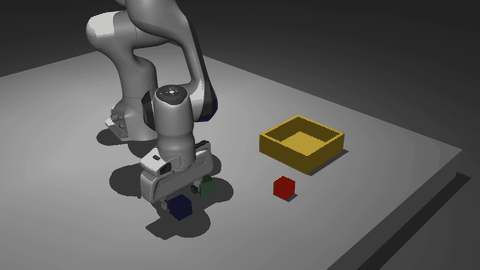
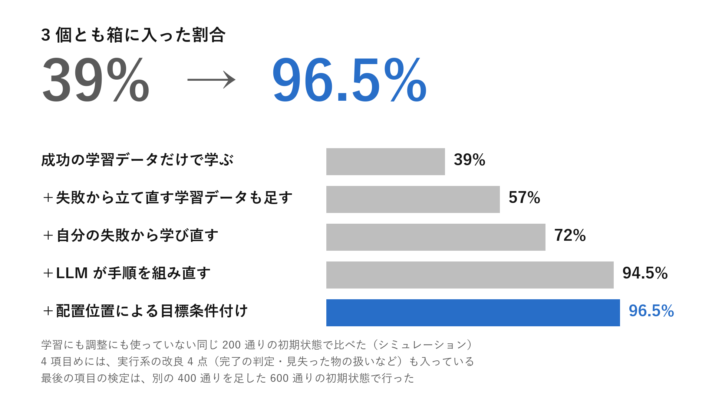
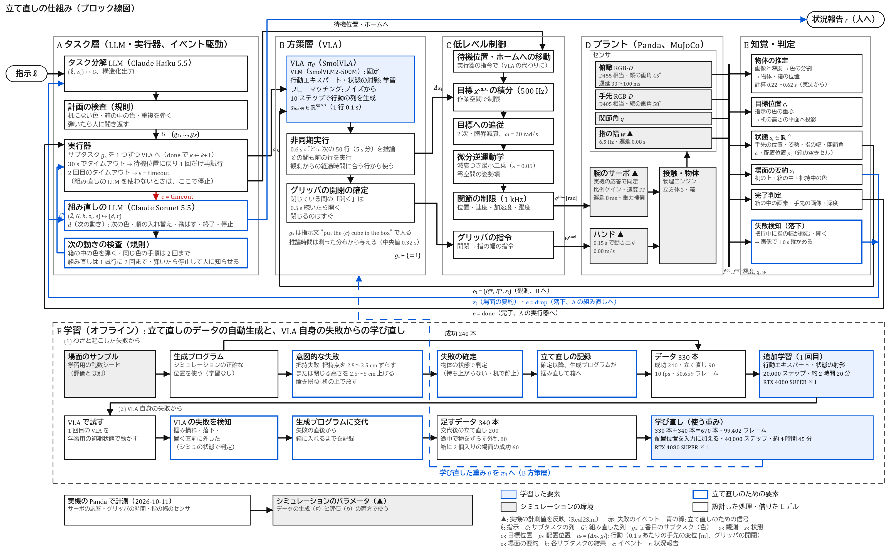
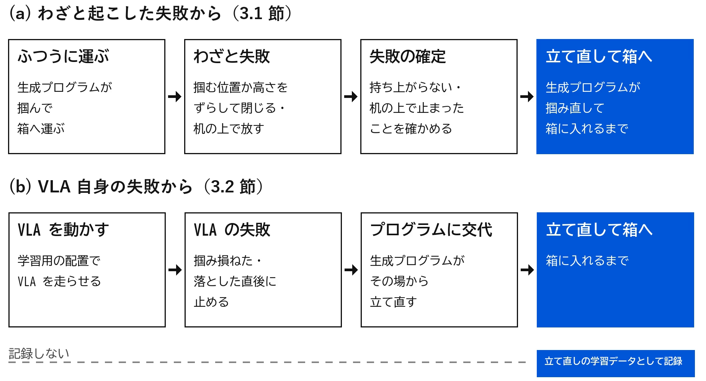
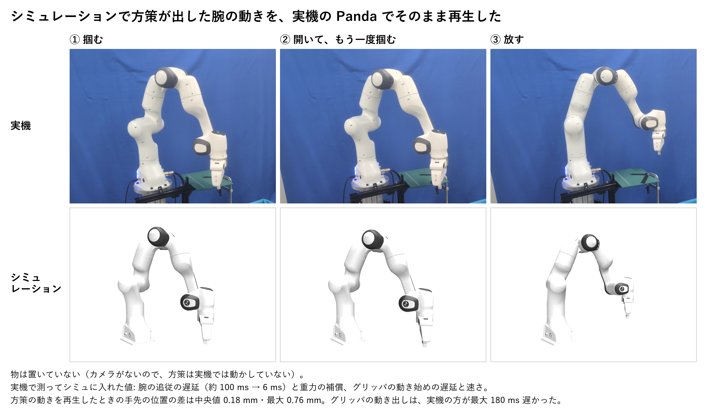
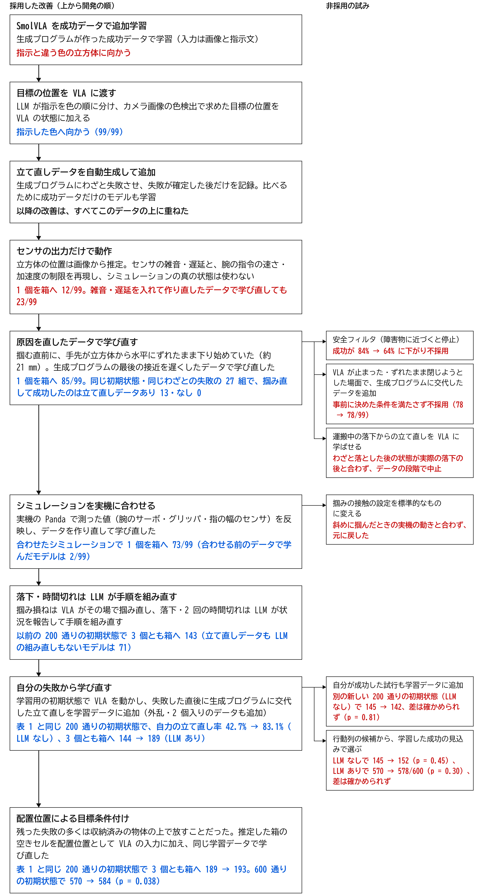

# 失敗からの立て直しを学ぶロボット

Physical AI 応用1講座 最終課題　／　omnicampus アカウント名: Fuji1192

**人の遠隔操作なしに、失敗からの立て直しを学ばせる。ロボットが失敗した場面で、生成プログラムが立て直した学習データを集めて学び直す。シミュレーション上の Franka Panda が立方体 3 個を箱に入れる割合は、立て直しの学習だけで 39.0% から 72.0% に上がり（LLM なし）、LLM による手順の組み直しと配置位置による目標条件付けを重ねて 96.5% になった（学習に使っていない同じ 200 通りの初期状態）。**

掴み損ねた直後に、その場で掴み直して箱へ入れる（立て直しの学習データも学んだ VLA、後半は 2 倍速）。

- 説明資料（PDF、11 ページ。RTC を足した評価は付録 A）: [docs/説明資料_PAI最終課題_Fuji1192.pdf](docs/説明資料_PAI最終課題_Fuji1192.pdf)
- 詳しい説明: この README の[説明資料の詳細](#説明資料の詳細)（学習データ・実行系の改良・実機に合わせたシミュレーション・評価の方法・参考の数）と、[評価の手順書](docs/api/r1_protocol.md)
- 実装の解説: [docs/implementation.md](docs/implementation.md)（どのファイルが何をして、学習データの生成から評価までどう流れるか）
- デモ動画: [YouTube「PAI最終課題_Fuji1192」](https://youtu.be/y7Wzc8WhawE)（2 分 59 秒。一部 2 倍速で、倍速の場面は画面の右上に表示）

## 問題とアイデア

将来の家庭のロボットは、置き場所も物も毎回違う中で、VLA のような学習した方策で片付けることになる。学習した方策は掴み損ねや落下を避けきれないが、失敗からの立て直しは人が手本を示しにくく、データを集めにくい。

本作は、立て直しを人の遠隔操作なしに学ばせる。シミュレーションの生成プログラムにわざと失敗させて立て直しデータを作り、さらに VLA 自身が失敗した場面から立て直すデータを集めて学び直す。方策だけでは抜け出せない失敗（運搬中の落下など）は、LLM が手順を組み直す。最後に、残った失敗で多かった「収納済みの物体の上で放すこと」に対して、推定した箱の空きセルを配置位置として VLA の入力に加え、目標条件付き方策として学び直す（学習データは増やさない）。MuJoCo 上の Franka Panda が、日本語の指示「全部片付けて」で机の上の立方体 3 個を箱に入れる。

本リポジトリは、(1) 学習データの自動生成、(2) SmolVLA の追加学習と自分の失敗からの学び直し・配置位置による目標条件付け、(3) 失敗の検知と LLM による手順の組み直しを含む実行系、(4) 評価と判定（比べる条件と検定は評価の前に固定）の一式である。シミュレーションは実機の Panda で測った応答に合わせてある。

## 主な結果

学習にも調整にも使っていない同じ 200 通りの初期状態（シミュレーション）。

| 学び方 | LLM の組み直し | 3 個とも箱へ | 自力の立て直し率 |
|---|---|---|---|
| 成功データだけ（240 本） | なし | 78（39.0%） | 8/110（7.3%） |
| ＋立て直しデータ（90 本） | なし | 114（57.0%） | 50/117（42.7%） |
| ＋自分の失敗から学び直す（＋340 本） | なし | 144（72.0%） | 59/71（83.1%） |
| ＋LLM の組み直し | あり | 189（94.5%） | 55/61（90.2%） |
| ＋配置位置による目標条件付け | あり | 193（96.5%） | 67/71（94.4%） |

上の 3 行が立て直しの学習の効果（LLM なし）。下の 2 行は、学習とは別に重ねた仕組み。LLM の改良は学習用の初期状態だけで確かめ、評価の初期状態では調整していない。配置位置による目標条件付けは、600 通り（この 200 通りを含む）の評価で残った失敗を分類した後に足した 1 本（下の表の最後の行）。自力の立て直し率は、掴み損ねのうち、方策が自分で掴み直して箱に入れた割合（掴み損ねの数え方の点検は下の「評価の方法」）。

評価の前に決めて固定した比較と、その結果（上がらなかったものも含む）:

| 比較 | 指標 | 基準 → 比較対象 | p | 判定 |
|---|---|---|---|---|
| 立て直しデータを足す | 自力の立て直し率 | 7.3% → 42.7% | 2.0×10⁻⁵（Holm 後） | 上がった |
| 自分の失敗から学び直す（LLM なし） | 自力の立て直し率 | 42.7% → 83.1% | 2.0×10⁻⁵（Holm 後） | 上がった |
| 自分の失敗から学び直す（LLM あり） | 3 個とも箱へ | 144 → 189/200 | 9.0×10⁻⁹（Holm 後） | 上がった |
| 自分の成功した試行も足して学び直す（別の 200 通り、LLM なし） | 3 個とも箱へ | 145 → 142/200 | 0.81 | 確かめられなかった |
| 行動列の候補から成功の見込みで選ぶ（別の 200 通り、LLM なし） | 3 個とも箱へ | 145 → 152/200 | 0.45 | 確かめられなかった |
| 同（LLM あり、600 通り） | 3 個とも箱へ | 570 → 578/600 | 0.30 | 確かめられなかった |
| 配置位置による目標条件付け（600 通り。残った失敗を分類した後・評価の前に足した 1 本） | 3 個とも箱へ | 570 → 584/600 | 0.038（補正なし） | 上がった（+2.3 pt、95% 信頼区間 +0.2〜+4.5。上がり幅は小さい） |

上の 3 本は 1 組として Holm 法で補正した。ほかは 1 本ずつ決めた比較で、補正していない。600 通りは、表の 200 通りに別の 400 通りを足したもの。

追加の試みとして、最終モデルに実時間の実行方式 RTC（Black ら, 2025）を足した評価は、[付録 A](#付録-a-実時間の実行方式-rtc-を足したときの引き換え) にまとめた。

## 仕組み

LLM（Claude Haiku 5.5）が指示を色の順に分け、VLA（SmolVLA）が俯瞰と手首の画像と状態から腕を動かし、知覚・判定が完了と落下を返す。運搬中の落下や同じ色での時間切れの繰り返しでは、組み直しの LLM（Claude Sonnet 5.5）が状況を報告して手順を組み直す。LLM の出力は規則で検査し、通らなければ止まって人に知らせる。A〜E は実行時、F は学習（オフライン）。青の塗りは学習した要素、青の枠は立て直しのための要素、灰色はシミュレーションの環境（▲ は実機の計測値を反映）。

| 学習したもの | 規則・既存のものに任せたもの |
|---|---|
| SmolVLA の行動エキスパートと状態の射影（画像 2 枚と 19 次元の状態から、50 ステップ分の手先の変位とグリッパの開閉） | 指示の分解と組み直し（Claude。出力は規則で検査）、逆運動学と指令の制限、知覚と完了・落下の判定（RGB-D と規則）、学習データを作る生成プログラム（学習なし）、物理（MuJoCo） |

自作した部分: 生成プログラムと失敗の起こし方、自分の失敗から学び直すデータの集め方、配置位置の付け方、実行系（知覚・判定・失敗の検知・LLM との受け渡し）、評価と判定の道具。SmolVLA・LeRobot・MuJoCo Menagerie の Panda は公開のものを使った。

## 説明資料の詳細

**学習データ**

- 立て直しデータ: 掴み損ねは掴む位置を 2.5〜3.5 cm ずらすか閉じる高さを 2.5〜5 cm 上げて起こし、置き損ねは机の上で放して起こす。失敗が物の状態で確定した後だけを記録する。掴み損ね 60・置き損ね 30。
- 最初の学習: 成功 240 本＋立て直し 90 本、50,659 フレーム、20,000 ステップ（RTX 4080 SUPER ×1 で約 2 時間 20 分）。
- 自分の失敗から学び直す: 学習した VLA を学習用の初期状態で動かし、失敗の直後に生成プログラムへ切り替えた交代後のデータ 200 本（掴み損ね 142・置く直前 55・その他 3）、外乱を入れたデータ 80 本、箱に 2 個入った場面の成功データ 60 本を、元の 330 本に足した 670 本（99,402 フレーム、立て直しのフレームは 45.5%）。40,000 ステップ。手順は[評価の手順書](docs/api/r1_protocol.md)。
- 配置位置による目標条件付け: LLM の組み直しまで加えた版の 600 通りの初期状態での失敗 30 本のうち 18 本は、収納済みの物体の上でグリッパを開いて物体を放し、物体が載ったまま静止したものだった。そこで状態に配置位置 p ∈ ℝ²（箱内の水平位置）を加え（17 → 19 次元）、目標条件付き方策として同じ 670 本で学び直した（データは追加しない、40,000 ステップ）。学習の配置位置は、各デモで対象物体が最終的に静止した位置を事後的に付与した（hindsight relabeling、シミュレーションの値、1 本の中で一定）。実行時は、サブタスクの開始時と再試行のたびに、RGB-D から推定した箱の内寸を 2×2 のセルに分け、収納済みの物体から最も遠いセルの中心を与える（シミュレーションの真値は使わない。600 試行の推論 72,103 回すべてで推定の値）。事後的に目標を付ける考え方は Andrychowicz ら（2017）、空いた配置位置を選んで与える点は Yuan ら（2024）に近い。本作では配置位置を VLA の入力とし、そこへ運んで放す動作まで VLA に学習させた。手順は[評価の手順書](docs/api/r2_protocol.md)。

**実行系の改良（評価の前に、学習用の初期状態だけで確かめた 4 点）**
- 指示文: LLM への指示で、実行器のやり直しと、色ごとの試行回数の上限を区別して書いた。
- 場面の要約: 箱の中の立方体の上に重なった立方体を「箱の中」に数えない。
- 完了判定: 手首カメラの画像と深度でも箱の中に物が確かめられるときは、俯瞰画像の色の画素数の閾値を半分にした。
- 見失い: 腕に隠れて見失った立方体は、腕を待機位置にどけて見直してから、手順から外すかを決める。

**実機に合わせたシミュレーション**: 実機の Panda（カメラなし、libfranka）で生成プログラムの関節の指令を 38 本再生し、サーボのゲイン・速度の先送り・指令の遅延・重力補償を合わせた。腕の追従の遅延 約 100 → 6 ms（実機 6〜8 ms。指令の遅延の設定は 8 ms）、グリッパの動き始めの遅延 0.15 s・速さ 0.08 m/s、指の幅のセンサ 約 6.5 Hz・遅延 0.08 s。この条件でデータの生成と学習をやり直した。シミュレーションで方策が出した腕の動きを実機で再生すると、手先の位置の差は中央値 0.18 mm・最大 0.76 mm（生成プログラムの指令の再生では、合わせる前の中央値 6.7 mm・最大 21.7 mm が、合わせた後 0.18 mm・1.16 mm）、グリッパの動き出しは実機の方が最大 180 ms 遅かった。物は置いておらず、学習した VLA を実機で閉ループで動かしてはいない（実機にカメラがない）。記録は [docs/real/](docs/real/)。

**評価の方法**: 1 試行は指示「全部片付けて」、手順ごとに 30 s・やり直し 1 回、全体で 200 s まで。3 個とも箱に入ったかの比較は同じ初期状態の組の McNemar 正確検定（両側）、立て直し率は分母が条件で違うので並べ替え検定（10 万回）とブートストラップの信頼区間。割合の信頼区間は Wilson 法、組の差は Newcombe 法。3 つの比較を Holm 法で補正（α = 0.05）。無効の試行は 0。同じ初期状態の組で条件を比べられるのは、同じ初期状態と物理を再現できるシミュレーションだからで、初期状態も接触も毎回変わる実機ではこの比べ方は使えない。

**掴み損ねの数え方の点検（評価の後に見つけた点）**: 掴み損ねは事前に決めた定義（目標から 6 cm 以内でグリッパが閉じたのに、どの立方体も 1.5 cm 上がらない。1 回の試みでは最初の 1 回だけ）で数えた。この定義では、持ち上げて運んだ立方体を放すときにグリッパを一瞬開いて閉じ直した回（直前の閉じた間に目標が 1.5 cm 以上上がり、開いてから 1 s 未満でまた閉じ、そのとき目標が置いた高さ＋1.5 cm より上。閉じた指の幅は 39 mm で立方体を挟んだまま）も掴み損ねに入り、直後に箱に入ると自力の立て直しにも数えられる。判定は定義どおりの数で行い、この回を除いた数は記述として示す。

| 学び方 | 定義どおり | 握り直しを除く |
|---|---|---|
| 成功データだけ | 8/110（7.3%） | 4/106（3.8%） |
| ＋立て直しデータ | 50/117（42.7%） | 40/107（37.4%） |
| ＋自分の失敗から学び直す | 59/71（83.1%） | 28/40（70.0%） |
| ＋LLM の組み直し | 55/61（90.2%） | 25/30（83.3%） |
| ＋配置位置による目標条件付け | 67/71（94.4%） | 27/31（87.1%） |

除いた数で同じ並べ替え検定をすると、立て直しデータを足す +33.6 pt（ブートストラップの 95% 信頼区間 +22.8〜+44.9、p = 1×10⁻⁵）、自分の失敗から学び直す +32.6 pt（+14.2〜+50.7、p = 2.4×10⁻⁴）で、Holm 法の補正の後もどちらも有意。成功データだけのモデルの残る 4 回は、何も挟まずに閉じた後に方策が接近し直し、約 20 s 後に掴んで入れたもの。自分の失敗から学び直したモデルは握り直しが多く（71 回のうち 31 回）、上がり幅は +40.4 pt から +32.6 pt に縮む。

**参考の数**
- 立て直しデータと LLM の組み直しの組み合わせ（3 個とも箱へ）: 成功データだけ 78・＋LLM 125、立て直しデータあり 114・＋LLM 144。交互作用は −8.5 pt（−20.5〜+3.5）ではっきりしない。
- 外乱（運ぶ途中に横から押して落とす、別の 100 通りの初期状態、LLM あり）: 学び直す前 64、学び直した後 83。
- 指示の分解を物の番号で行う版（LLM だけ、ロボットは動かさない 20 の場面）: いまの色で分ける版は 10/20、物に番号・種類・色・位置を渡す版は 19/20。差は同じ色が複数・立方体以外の物・位置で指す指示の場面で出た。実際に動かすには知覚・判定・VLA への指示も変える必要がある。[docs/api/object_decompose_check.md](docs/api/object_decompose_check.md)
- 自分の成功した試行も足したモデル（別の 200 通りの初期状態、LLM なし）: 立て直しデータまで 105、＋自分の失敗から学び直す 145、＋自分の成功した試行も足す 142。手順は[評価の手順書](docs/api/r2_protocol.md)。

**作品の変遷**

左は採用した改善（上から開発の順）、右は非採用の試み。青は改善した結果、赤は課題・改善しなかった結果。/99 は開発中の 99 試行（立方体 1 個）、/200 は 200 通りの初期状態（3 個とも）。項目ごとに初期状態と回数が異なるので、数は項目の中だけで比べる。上の表と同じ評価は最後の 2 項目だけ。

## 限界

- 方策の評価はシミュレーションだけ。実機にはカメラがないので、シミュレーションで方策が出した腕の動きを実機で再生しただけで、学習した VLA を実機で閉ループで動かしてはいない。
- 同じ初期状態で条件を組にして比べる方法は、同じ初期状態と物理を何度でも再現できるシミュレーションだから成り立つ。初期状態も接触も毎回変わる実機では、この比べ方は使えない。
- 学習のシード値は各モデル 1 つで、学習のばらつきは結果に含まない。
- 手先は真下向きに固定し、手首の向きを変えない。残った失敗の多くは、向きのずれた立方体での掴み損ね。
- 物を色で見分けている（指示の分解・知覚・完了の判定・VLA への指示）。同じ色の物が複数ある場面や、立方体以外の物には広がらない。
- 自分の失敗からの学び直しと成功の見込みの学習は、このタスクの試行から行った。タスクが変わるたびに試行を集め直す必要がある。
- 生成プログラムはシミュレーションの正確な位置を使う。形の決まった物（剛体）なら、産業用ロボットと同じく、推定した位置・姿勢から掴み方と経路を計算するスクリプト方策で、実機でもデータを作れると考えている（確かめたのは立方体だけ）。布や食品のような柔軟物は、スクリプト方策ではデータを作りにくい。

## リポジトリの構成

| 場所 | 役割 |
|---|---|
| src/recovla/expert・sim・harness | 生成プログラム（成功データと立て直しデータ）、MuJoCo の場面と制御、実機に合わせた腕とグリッパ |
| src/recovla/data・policy | LeRobot 形式への変換、SmolVLA の学習と推論 |
| src/recovla/runtime・api・planner・perception | 実行系（知覚、非同期の方策の実行、指令の制限、逆運動学、完了判定、失敗の検知、LLM の分解と組み直し） |
| src/recovla/eval・rl | 評価と統計、行動列の候補から選ぶための成功の見込みの学習 |
| scripts/real・failure_relearn・place_relearn・success_relearn・chunk_select | 学習データの生成と学習・実機での再生の道具、自分の失敗からの学び直し、配置位置による目標条件付け、自分の成功した試行も足す試み、候補から選ぶ試み |
| scripts/api | 評価の入口（ladder.py）、評価の計画と判定（plan_failure_relearn.py・judge_failure_relearn.py・plan_success_relearn.py・judge_success_relearn.py）、動画の撮り直し |
| configs・assets/mjcf | 設定（実機に合わせた値は configs/v3_real.yaml）、場面と Franka Panda のモデル（MuJoCo Menagerie） |
| docs/api・docs/real・docs/figures | 評価の手順書（事前に決めた比較）、実機の測定と学習データの作り直しの記録、この README の図 |
| results | 1 試行ごとの結果（`trials.csv`、付録 A の `rtc_trials.csv`。表の数字は `scripts/recount_results.py` で数え直せる） |
| tests | テスト（pytest） |

## 再現に要るもの

- 表の数字を GPU なしで数え直す: `python scripts\recount_results.py`（`results/trials.csv` の 1 試行ごとの結果 3,800 行から、表 1・2、握り直しを除いた感度分析、追加の試みの p を、`results/rtc_trials.csv` の 800 行から付録 A の p を数秒で出す。numpy だけ使う）
- 含まないもの: 学習したモデル、データセット、評価の記録（`outputs/`）と、初期値のモデル（`models/`）。初期値は Hugging Face の `lerobot/smolvla_libero` と `HuggingFaceTB/SmolVLM2-500M-Video-Instruct` を `models\hf_home\` に置く。
- 機材: Windows、NVIDIA GPU 1 枚（RTX 4080 SUPER で確かめた）。LLM を使う評価には Anthropic API の鍵（環境変数 `ANTHROPIC_API_KEY`）。
- 環境: `env\setup_env.ps1` で `.venv` を作る（版は `env\requirements-lock.txt`）。テストは `python -m pytest -m "not needs_outputs"`。
- 順序（各スクリプトの先頭に使い方がある）:
  1. 学習データの生成: `scripts\real\regen_data.py plan` → `gen-data`
  2. 最初の学習: `scripts\real\regen_train.py Rreal --start`（`Rreal` は成功データ＋立て直しデータ、`Nreal` は成功データだけのモデルの名前）
  3. 自分の失敗から学び直すデータと学習: `scripts\failure_relearn\failure_data.py handover`・`demos`・`data` → `scripts\failure_relearn\train_rdag.py --start`
  4. 評価と判定: `scripts\api\plan_failure_relearn.py` → `scripts\real\rotate_jobs.py configs\rotate\plan_r1e_a.json` → `scripts\api\judge_failure_relearn.py check`
  5. 配置位置による目標条件付けの学習と評価: `scripts\place_relearn\place_data.py manifest` → `convert` → `scripts\place_relearn\train_place.py --dataset … --start` → `scripts\api\plan_success_relearn.py --stage-p --rplace-ckpt …` → `scripts\place_relearn\run_place_eval.ps1` → `scripts\api\judge_success_relearn.py check-p`
  6. 追加の試み: `scripts\success_relearn\`（自分の成功した試行も足す）、`scripts\chunk_select\`（候補から選ぶ）、判定は `scripts\api\judge_success_relearn.py`
- 自分の失敗から学び直す評価は 2 台の PC で 100 通りずつ回した（2 台目の分は名前が `_b` で終わる計画）。自分の成功した試行も足したモデルの評価は 1 台で 200 通りの初期状態。配置位置による目標条件付けの評価（600 通りの初期状態）は、2 台の PC が共有のフォルダの印で 18 個の計画を取り合って回した。GPU の推論の計算はわずかに揺れるので、回し直した結果は完全には一致しない。
- 評価と学習の起動の道具の一部（`scripts\chunk_select\`・`place_relearn\`・`rtc\`・`success_relearn\` の `.ps1` と、前の段のモデルを読む `.py`）は、評価に使ったままの形で入れたので、作者の PC の作業場所の絶対パスを既定値に持つ。自分の PC で回すときは、引数かファイルの先頭の値を自分の場所に替える。

## AI 支援の使用

プログラムの作成と文章の推敲に生成 AI（Claude Code）を使った。作ったシステムの中では、指示の分解と手順の組み直しに LLM（Claude Haiku 5.5・Claude Sonnet 5.5、Anthropic API）を使っている。

## 参考文献

説明資料の本文では著者（年）だけを書いた。

- Shukor ら（2025）: M. Shukor ほか, "SmolVLA: A Vision-Language-Action Model for Affordable and Efficient Robotics," arXiv:2506.01844, 2025.
- Marafioti ら（2025）: A. Marafioti ほか, "SmolVLM: Redefining small and efficient multimodal models," arXiv:2504.05299, 2025.
- Zhao ら（2023）: T. Z. Zhao, V. Kumar, S. Levine, C. Finn, "Learning Fine-Grained Bimanual Manipulation with Low-Cost Hardware," Robotics: Science and Systems (RSS), 2023.
- Ross ら（2011）: S. Ross, G. Gordon, D. Bagnell, "A Reduction of Imitation Learning and Structured Prediction to No-Regret Online Learning," AISTATS, pp. 627–635, 2011.
- Andrychowicz ら（2017）: M. Andrychowicz ほか, "Hindsight Experience Replay," Advances in Neural Information Processing Systems (NeurIPS), 2017.
- Yuan ら（2024）: W. Yuan ほか, "RoboPoint: A Vision-Language Model for Spatial Affordance Prediction in Robotics," Conference on Robot Learning (CoRL), 2024.
- Nakamoto ら（2024）: M. Nakamoto ほか, "Steering Your Generalists: Improving Robotic Foundation Models via Value Guidance," Conference on Robot Learning (CoRL), 2024.
- ファナック（JIMTOF2026）: 第 33 回日本国際工作機械見本市（東京ビッグサイト、2026 年 10 月）のファナックの展示（作者の見学）。出展の案内は https://www.fanuc.co.jp/ja/JIMTOF2026/
- Liu ら（2023）: B. Liu ほか, "LIBERO: Benchmarking Knowledge Transfer for Lifelong Robot Learning," NeurIPS Datasets and Benchmarks Track, 2023.
- Todorov ら（2012）: E. Todorov, T. Erez, Y. Tassa, "MuJoCo: A physics engine for model-based control," IEEE/RSJ International Conference on Intelligent Robots and Systems, pp. 5026–5033, 2012.
- Cadene ら（2024）: R. Cadene ほか, "LeRobot: State-of-the-art Machine Learning for Real-World Robotics in Pytorch," https://github.com/huggingface/lerobot, 2024.
- Black ら（2025）: K. Black, M. Y. Galliker, S. Levine, "Real-Time Execution of Action Chunking Flow Policies," arXiv:2506.07339, 2025.
- Park・Tulsiani（2026）: S. Park, S. Tulsiani, "πR²: Reactive Real-time Flow Policies," arXiv:2607.26055, 2026.

## 第三者のコードとモデル

Franka Panda のモデルは MuJoCo Menagerie（Apache-2.0）、学習は LeRobot、方策は SmolVLA を使った。詳しくは [THIRD_PARTY_NOTICES.md](THIRD_PARTY_NOTICES.md)。

## 付録 A. 実時間の実行方式 RTC を足したときの引き換え

VLA は 50 ステップ（5 s）分の行動列をまとめて出し、推論（約 0.34 s）の間も前の行動列の続きを実行する（非同期実行）。新しい行動列に替わる所では、手先の速さの指令に段差ができる。RTC（Black ら, 2025）は、新しい行動列を作るときに前の行動列の残りへ寄せて、この段差を小さくする方法で、学習は変えずに推論のときだけ使える（LeRobot にも実装がある）。寄せの重みは、推論の間に実行してしまう先頭の約 4 ステップで 1、その先は寄せる範囲の終わりに向けて 0 まで減る。β は寄せる強さの上限。

最終モデル（配置位置による目標条件付け、LLM あり）に RTC を足し、主な結果の表と同じ 200 通りの初期状態で、RTC なしの記録と組にして比べた。3 つの設定・指標・検定は、評価の前に決めて固定した（[評価の決まり](docs/api/r2_protocol.md) の 4・6 節、比較 G・H）。3 個とも箱へは McNemar 正確検定、段差は試行ごとの中央値の Wilcoxon の符号順位検定で、それぞれ 3 つの設定を Holm 法で補正した（α = 0.05）。

| RTC の設定 | 寄せる範囲・減り方・β | 3 個とも箱へ | 差（95% 信頼区間） | Holm 後の p | 判定 | つなぎ目の段差（中央値） |
|---|---|---|---|---|---|---|
| なし（最終モデル） | — | 193/200 | — | — | — | 5.5 mm/s |
| 原典の設定 | 44 ステップ（前の行動列の残り全体）・指数・5 | 158/200 | −17.5 pt（−24.0〜−11.2） | 5.3×10⁻⁷ | 下がった | 3.4 mm/s |
| LeRobot の既定 | 10 ステップ（実際に使う所まで）・線形・10 | 192/200 | −0.5 pt（−4.7〜+3.6） | 1 | 確かめられなかった | 3.2 mm/s |
| 先頭だけそろえる | 推論の間の約 4 ステップだけ・—・5 | 198/200 | +2.5 pt（−0.7〜+6.1） | 0.36 | 確かめられなかった | 4.5 mm/s |

段差は 3 つの設定とも小さくなった（Holm 後の p は 9.8×10⁻²⁵、1.3×10⁻²⁷、3.6×10⁻¹³）。段差は、使う行動列が替わった所での手先の速さの指令の差の大きさ（保持・試行の始め・手順の切り替えをまたぐ所は除く）。参考に、行動列の中の続くステップの差は 2.1〜2.3 mm/s。

記述（判定に使わない。評価の後に記録から数えた）:

| | なし | 原典の設定 | LeRobot の既定 | 先頭だけそろえる |
|---|---|---|---|---|
| 掴み損ね（握り直しを除く。1 回の試みでは最初の 1 回） | 31 | 329 | 154 | 73 |
| うち自力で掴み直して箱へ | 27（87.1%） | 149（45.3%） | 123（79.9%） | 66（90.4%） |
| 掴み損ねの 1 s 後に、手先が箱の方へ動いていた | 0 | 63 | 4 | 0 |
| 次にグリッパを閉じるまで（中央値） | 5.0 s | 3.8 s | 4.1 s | 4.9 s |

自力の立て直し率の差（なしとの並べ替え検定）は、原典の設定 −41.8 pt（ブートストラップの 95% 信頼区間 −53.8〜−28.1、p = 1×10⁻⁵）、LeRobot の既定 −7.2 pt（p = 0.35）、先頭だけそろえる +3.3 pt（p = 0.62）。原典の設定で失敗した 42 本のうち 35 本は、目標が一度も持ち上がらなかった失敗（机の上に残る 29、ロボットの側へ押し出す 6）で、RTC なしの失敗 7 本ではこの種類は 2 本だった。

記録から見えること: 原典の設定では、掴み損ねた 1 s 後の手先の速さの指令が、掴む前に予定していた「箱へ運ぶ」向きを向いた回が 63/329 あり、RTC なしでは 0/31 だった。前の行動列の残り全体に寄せると、掴み損ねた後も運ぶ動きが続き、その場での掴み直しが妨げられた様子が見える。ただし、次にグリッパを閉じるまでの時間は長くなっておらず、掴み直しへの切り替えが一様に遅くなったわけではない。掴み損ねそのものが増えた理由はまだ切り分けていない。寄せる範囲を実際に使う 10 ステップに絞ると、段差を小さくしたまま成功を保てた。

位置づけ: πR²（Park・Tulsiani, 2026）は、RTC が方策を前の動きに偏らせ、失敗からの立て直しに苦労すると書き、実機の 1 つの課題で、学習時に条件付ける RTC で 10/20、非同期実行で 12/20 を示した（検定なし）。本作は、同じ 200 通りの初期状態の組で、タスクの成功・自力の立て直し・段差を同時に数え、寄せる範囲によって引き換えが変わることを示した。結論は、このモデル（SmolVLA に配置位置による目標条件付け）、このタスク（立方体 3 個、シミュレーション）、推論を 6 ステップごとに始める 1 つの条件でのもので、範囲と β を 1 つずつ変えた比較や、ほかのモデルでの確かめは今後の課題。
