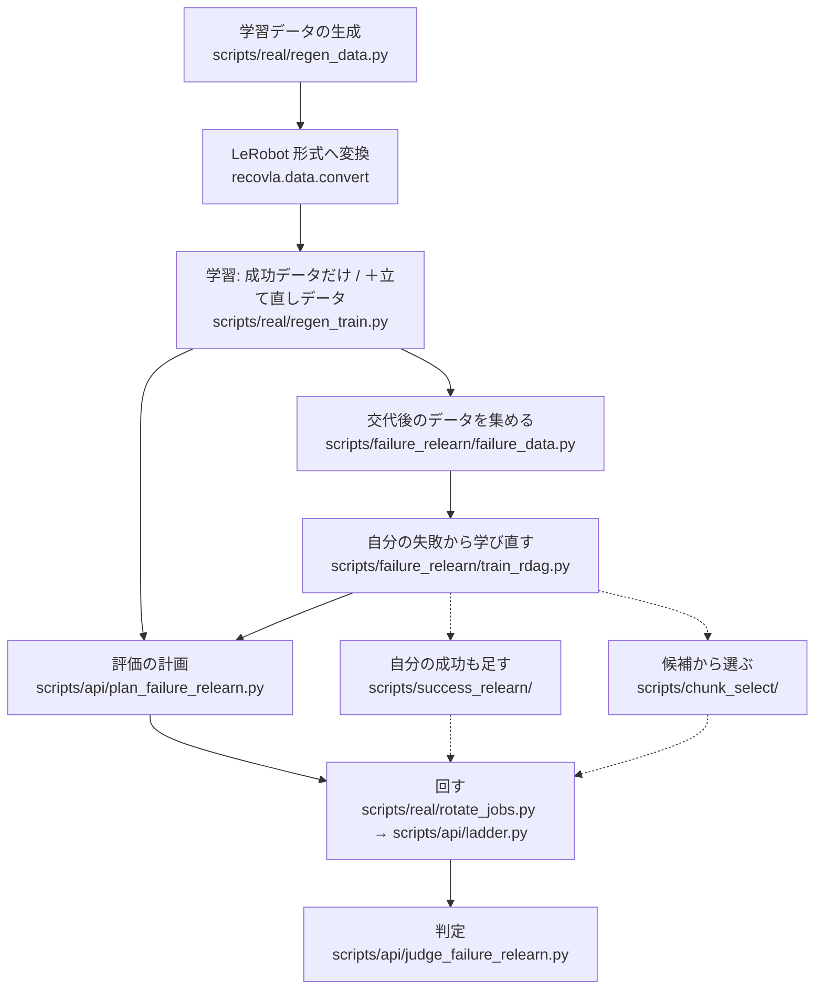
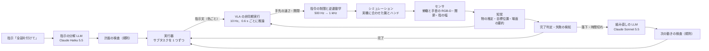

# 実装の解説

このリポジトリのコードが何をして、学習データの生成から評価の判定までどうつながるかをまとめる。結果と数字は [README](../README.md) にある。各スクリプトの先頭の docstring に使い方がある。

## 0. 全体の地図

コードは `src/recovla/`（部品）と `scripts/`（入口）に分かれる。入口のスクリプトが部品を組み合わせる。

| パッケージ | 中身 |
|---|---|
| [`sim/`](../src/recovla/sim/) | MuJoCo の場面（配置の抽選・座標・接触の計測）、逆運動学の制御器 |
| [`harness/`](../src/recovla/harness/) | シミュレーションの世界の側: 作動とセンサのモデル、評価の 1 試行の繰り返し、実機に合わせた腕とハンド |
| [`expert/`](../src/recovla/expert/) | 生成プログラム（学習しないスクリプト方策）、わざと失敗させる仕組み、交代後のデータの収集 |
| [`record/`](../src/recovla/record/)・[`data/`](../src/recovla/data/) | エピソードの記録と再生、LeRobot 形式への変換、VLA の入力（画像・状態）の定義 |
| [`policy/`](../src/recovla/policy/) | SmolVLA の学習の起動と、推論の時間の流れ |
| [`runtime/`](../src/recovla/runtime/) | 実行系: 実行器、非同期の方策の実行、指令の制限、知覚、完了判定 |
| [`api/`](../src/recovla/api/) | タスクの書式・センサと知覚の窓口、失敗の検知、実行器の改良 |
| [`planner/`](../src/recovla/planner/) | LLM の指示の分解と組み直し、それぞれの規則の検査 |
| [`eval/`](../src/recovla/eval/) | 評価の外乱・監査・統計 |
| [`rl/`](../src/recovla/rl/) | VLA を固定したまま行動列を選ぶ追加の試み |
| [`common/`](../src/recovla/common/) | 設定の読み込み、乱数のシード、コードの版の記録 |

決まり:
- 実行系（`runtime/`・`api/`・`planner/`）はシミュレーションの真の状態を読まない。センサの出力（[`runtime/types.py`](../src/recovla/runtime/types.py) の `SensorFrame`）と既知の情報（`SetupInfo`）だけを受け取る。[`scripts/check_real_boundary.py`](../scripts/check_real_boundary.py) が構文木で確かめ、評価では試行ごとに監査する（[`harness/audit.py`](../src/recovla/harness/audit.py)）。
- 学習用のシードは 100000 未満、評価のシードは 100000 以上（[`configs/default.yaml`](../configs/default.yaml) の `seeds`）。

## 1. 全体の流れ



| 段 | 入口 | 出力 |
|---|---|---|
| 学習データの生成 | `scripts/real/regen_data.py plan` → `gen-data` | 生の記録（PNG と npz）→ 変換したデータセット |
| 最初の学習 | `scripts/real/regen_train.py Rreal --start`（`Nreal` も同じ） | `Rreal`（成功データ＋立て直しデータで学習したモデル）、`Nreal`（成功データだけのモデル） |
| 自分の失敗からの学び直し | `scripts/failure_relearn/failure_data.py handover`・`demos`・`data` → `train_rdag.py --start` | `Rdag`（自分の失敗から学び直したモデル） |
| 評価 | `scripts/api/plan_failure_relearn.py` → `scripts/real/rotate_jobs.py <計画>` | 試行ごとの json・npz |
| 判定 | `scripts/api/judge_failure_relearn.py check` | 事前に決めた比較の検定の結果 |

生成プログラムだけのデータの生成は CPU で回る。VLA を動かす交代後のデータの収集・学習・評価は GPU を使う。学習の入口は、既定では渡す設定を出すだけで、`--start` のときだけ学習する。

## 2. 実行時の 1 試行



区分はブロック線図（[README](../README.md) の「仕組み」、[`scripts/report_figs.py`](../scripts/report_figs.py) の `fig_detail`）と同じ。A タスク層・B 方策層・C 低レベル制御・D プラント・E 知覚と判定・F 学習。

1. **時計**（D）: 物理は 2 ms ごとの 1 ステップで、止まらずに進む。評価の繰り返し（[`harness/task_loop.py`](../src/recovla/harness/task_loop.py) の `run_task_trial`）が 1 ステップごとに実行器の `tick` を呼び、出た関節の指令を世界に渡す。実行器は 50 Hz で制御し、20 Hz で完了判定をかける（[`runtime/executor.py`](../src/recovla/runtime/executor.py) の `tick`）。
2. **指示の分解と計画の検査**（A）: 起動時の知覚が机の上と箱の中の色を数え、[`planner/decompose_haiku.py`](../src/recovla/planner/decompose_haiku.py) が指示を色の列（サブタスク）に分ける。出力は JSON のスキーマで受け、[`planner/decompose.py`](../src/recovla/planner/decompose.py) の `check` が「机の上の色だけ・箱の中の色を含まない・重複なし」を確かめる。通らなければ手順を空にして人に尋ねる。
3. **実行器**（A）: サブタスクを 1 つずつ、指示文 `put the {color} cube in the box` で VLA に渡す。完了判定が出たら次へ進む。30 s で終わらなければ待機位置に戻して 1 回だけやり直し、それでも駄目なら止まる（組み直しのある条件では LLM に頼む）。全体は 200 s まで。
4. **非同期の方策の実行**（B、[`runtime/runner.py`](../src/recovla/runtime/runner.py) の `PolicyRuntime`）: 0.1 s の区切りごとに 1 行を実行する。行動列は 50 行 × 7（手先の位置の変化 3、回転 3 は 0、開閉 1）。前の推論を始めてから 6 行（0.6 s）たつと、次の推論を始める。その間も前の行動列を実行し続ける（実行の方式 `naive`）。
   - 推論の時間: [`harness/robot_io.py`](../src/recovla/harness/robot_io.py) の `SimRobotIO.compute` が、計算をすぐ行い、結果を「始めた時刻＋時間」から使えるようにする（`Pending`）。時間は GPU で実測した分布（[`configs/latency_v1.json`](../configs/latency_v1.json)、中央値 0.32 s）から試行のシードで引く。使える前に使うと例外で止まる。
   - 届いた行動列は、観測から経過した行の位置から使う。行動列がない間（最初・サブタスクの切り替えの直後）は腕をその場で保持する。
   - 開閉は 7 番目の値の符号で決め、開く指令は 5 回続いたときだけ実行する（`--grip-debounce 5`、[`scripts/real/eval_real_matched_grip.py`](../scripts/real/eval_real_matched_grip.py)）。
5. **指令の制限と逆運動学**（C、[`runtime/motion.py`](../src/recovla/runtime/motion.py) の `Motion`）: 手先の速さを 500 Hz で積分し、追従器と減衰つき最小二乗の微分逆運動学（[`sim/controller_ik.py`](../src/recovla/sim/controller_ik.py)）で関節角にする。[`runtime/limiter.py`](../src/recovla/runtime/limiter.py) が libfranka の `limitRate` と同じ式で速度・加速度・躍度を上限に収め、1 kHz 相当の関節の位置の指令を出す。逆運動学はロボットだけのモデル（[`runtime/robot_model.py`](../src/recovla/runtime/robot_model.py)）で解く。
6. **シミュレーション**（D）: [`harness/world.py`](../src/recovla/harness/world.py) の世界に、実機に合わせた腕のサーボとハンド（7 節）を入れる。センサは [`harness/sensors.py`](../src/recovla/harness/sensors.py)（カメラ 30 fps、遅延・雑音・較正誤差つき）。
7. **知覚**（E、[`runtime/perception.py`](../src/recovla/runtime/perception.py)）: 10 Hz で、RGB-D の色の切り出しから立方体と箱を推定する（状態 seen・held・in_hand・lost）。知覚の計算にも固定の遅延（0.22 s、点群からの形の推定を足すと 0.62 s）を入れる。目標位置の入力（俯瞰画像の指示の色の重心を机の高さへ投影した位置）は [`runtime/cue.py`](../src/recovla/runtime/cue.py) の `TargetCue`。VLA の観測は [`runtime/policy.py`](../src/recovla/runtime/policy.py) が学習と同じ関数（[`data/vla_observation.py`](../src/recovla/data/vla_observation.py)）で作る。
8. **完了判定**（E、[`runtime/judge.py`](../src/recovla/runtime/judge.py) の `JudgeV2`）: 次の 3 つが 1.0 s 続いたら完了。(1) 箱の中にその色がある（俯瞰の画素・手首の画像の画素と割合・深度の上面の高さ）、(2) 指が開いている、(3) 手が待機位置で止まっている。
9. **失敗の検知と組み直し**（A・E）: 運ぶ途中の落下を見つけたら、時間切れを待たずに組み直しを頼む。LLM（[`planner/replan_improved.py`](../src/recovla/planner/replan_improved.py)）は指示・計画・手順ごとの結果・場面の要約を受け、次の動き（次の色・並べ替え・飛ばす・飛ばして最後に知らせる・終える・止める）と日本語の報告を返す。[`planner/replan_base.py`](../src/recovla/planner/replan_base.py) の `check` が次の動きを検査する（同じ色は 2 回まで、組み直しは 1 試行で 2 回まで）。通らなければ止まって人に知らせる。LLM の応答の時間も実測の分布から引き、その間も世界は進む。

### 実行器の重ね

実行器は、元のクラスを書き換えずに、`install` でクラスを差し替えて機能を重ねる。

| 重ね | ファイル | 足すこと |
|---|---|---|
| 基本 | [`runtime/executor.py`](../src/recovla/runtime/executor.py) の `TaskRuntime` | 分解・サブタスクの切り替え・完了判定・待機位置へ戻す動き・やり直し |
| 組み直し | [`runtime/executor_replan.py`](../src/recovla/runtime/executor_replan.py) の `ReplanTaskRuntime` | 時間切れで止まる所で、腕を保持して LLM に頼み、答えの並びで続ける |
| 落下の早い検知 | [`runtime/executor_replan_early.py`](../src/recovla/runtime/executor_replan_early.py) の `EarlyReplanTaskRuntime` | 手の中にあった色が箱の外に戻ったら、時間切れを待たずに頼む |
| 失敗の検知 | [`api/executor_monitored.py`](../src/recovla/api/executor_monitored.py) の `MonitoredReplanTaskRuntime` | 上の判定を [`api/monitors.py`](../src/recovla/api/monitors.py) の検知に替える（指の幅の変化をカメラで 1.0 s 確かめる `GraspDropMonitor`、推定の位置で見る `HeldEstimateDropMonitor`） |
| 改良 4 点 | [`api/executor_improved.py`](../src/recovla/api/executor_improved.py) | 下の 4 点と、検知 `ExpectedInHandMonitor`（[`api/monitors_in_hand.py`](../src/recovla/api/monitors_in_hand.py)、持っていたはずの物が手の中にない） |
| 手順の切り替え | [`diag/step_reset.py`](../src/recovla/diag/step_reset.py) の `StepResetMixin` | 2 番目以降のサブタスクの前に腕を home の関節角へ戻す（`--step-reset home`、どの条件にも掛ける） |

改良 4 点（評価の前に学習用の配置だけで確かめたもの）:
- 指示文: 実行器のやり直しの回数と、色ごとに組める回数を分けて LLM に渡す（[`planner/replan_improved.py`](../src/recovla/planner/replan_improved.py)）。
- 場面の要約: 箱の中の立方体の上に重なった色を「箱の中」から外す。壁ぎわの色も足す（[`api/scene_summary.py`](../src/recovla/api/scene_summary.py) の `refine`）。
- 完了判定: 手首の画像と深度で箱の中が確かめられるときは、俯瞰の画素の閾値を緩める（[`api/judge_improved.py`](../src/recovla/api/judge_improved.py)）。
- 見失い: 腕に隠れて見失った色は、腕を待機位置にどけて 1.0 s 待って見直してから頼む（`executor_improved.py` の `_begin_look`）。

LLM の組み直しなしの条件は「基本＋手順の切り替え」、ありの条件はすべての重ねで回す。点群からの形の推定（[`api/estimated.py`](../src/recovla/api/estimated.py)・[`api/geometry.py`](../src/recovla/api/geometry.py)）は、組み直しありの条件で知覚に被せる。既知の箱や立方体の寸法は読まない。

## 3. 段ごとの入口と主なモジュール

### 3.1 学習データの生成

| ファイル | 役割 | 主な関数・クラス |
|---|---|---|
| [`scripts/real/regen_data.py`](../scripts/real/regen_data.py) | 計画（[`scripts/recovery_data.py`](../scripts/recovery_data.py) の `cmd_plan` を呼ぶ）→ 生成 → 変換と照合。止まっても続きから回せる | `cmd_plan`・`cmd_gen_data`・`generate_resumable` |
| [`expert/generate.py`](../src/recovla/expert/generate.py)・[`generate_real.py`](../src/recovla/expert/generate_real.py) | 1 本ずつ生成し、生成プログラムが失敗したらシードを変えて作り直す。`generate_real` は実機に合わせた世界で回す | `generate`・`run_attempt` |
| [`expert/script.py`](../src/recovla/expert/script.py) | 生成プログラム。20 ms ごとに真の状態から動作の局面（接近・下降・閉じる・持ち上げ・運ぶ・放す・開き直す など）を決め直す。内部に局面を持たないので、失敗の後もそのまま立て直す | `Expert`・`phase_of` |
| [`expert/inject.py`](../src/recovla/expert/inject.py) | わざと失敗させる。生成プログラムの指令を上書きする | `Injector`・`sample_params`・`landing_check` |
| [`harness/gen_sensed.py`](../src/recovla/harness/gen_sensed.py)・[`driven.py`](../src/recovla/harness/driven.py) | 生成プログラムの指令を実行系と同じ経路（逆運動学・制限）で流し、実行時と同じセンサのモデルで記録する | `SensedDrivenRig`・`DrivenRig` |
| [`record/episode.py`](../src/recovla/record/episode.py) | 1 本を `overhead/`・`wrist/` の PNG、`data.npz`、`meta.json` に書く | `SceneEpisodeWriter` |

わざと失敗させる所（`inject.py` の表。数値は [`configs/default.yaml`](../configs/default.yaml) の `inject`）:
- 掴み損ね: 下降か閉じる局面に入ったら、掴む点を水平にずらすか閉じる高さを上げて閉じ、持ち上げる。
- 置き損ね: 箱の上で開く代わりに、机の上の別の場所へ運んで放す。
- 運ぶ途中の落下: 運ぶ途中で指を開く。最初の学習データでは使わず、学び直しの外乱のデータで使う。

失敗の確定は物の状態で判定する（`Injector.status` が `confirmed`）。掴み損ねは、手が上がったのに立方体が上がっていないこと。置き損ねと落下は、立方体が指の間になく机の上で止まったこと。着地の検査（傾き・箱の縁の上・ほかの物に近い・カメラに写らない）に外れたものは保存しない。

記録の範囲: 確定した時点から記録を始める。失敗させている間は記録しないので、学習データに失敗の動作は入らない。記録を始めた後は、生成プログラムが立て直す（立て直し専用の分岐はない）。

### 3.2 変換と学習

| ファイル | 役割 | 主な関数・クラス |
|---|---|---|
| [`data/convert.py`](../src/recovla/data/convert.py) | 生の記録を LeRobot v3.0 形式（10 fps、画像を埋め込み）にする。`--verify` で読み戻して照合する | `convert`・`verify` |
| [`data/vla_state.py`](../src/recovla/data/vla_state.py)・[`vla_image_spec.py`](../src/recovla/data/vla_image_spec.py) | 状態（手先の位置・真下向きからの姿勢のずれ・指・関節の 15 次元。目標位置の入力 x, y を足す）と画像の向きの定義。学習と評価が同じ関数を使う | `policy_state`・`with_cue`・`to_policy_image` |
| [`scripts/real/regen_train.py`](../scripts/real/regen_train.py) | `Rreal`・`Nreal` の学習の入口。設定は [`scripts/train_seed.py`](../scripts/train_seed.py) の `build_cfg` から作り、データセット以外の違いがあれば止める | `build_cfg`・`post_check` |
| [`policy/train_launcher.py`](../src/recovla/policy/train_launcher.py) | `lerobot-train` を 1 回起動する。初期値は `lerobot/smolvla_libero`、学習する範囲は行動エキスパートと状態の射影 | `run`・`build_command` |
| [`policy/train_wrapped.py`](../src/recovla/policy/train_wrapped.py) | LeRobot を書き換えずに差し替える: エピソードの最初の 20 フレームを 5 倍引く並べ方、目標位置の入力を学習時だけ 0〜2 cm ずらす | `WeightedEpisodeAwareSampler`・`CueAugment` |

行動は「そのフレームから 0.1 s 後までの手先の目標位置の変化」と開閉（+1 閉・−1 開）。学習の設定（バッチ 32・シード 1000 など）は `configs/default.yaml` の `train`。

### 3.3 自分の失敗から学び直す

| ファイル | 役割 | 主な関数・クラス |
|---|---|---|
| [`scripts/failure_relearn/failure_data.py`](../scripts/failure_relearn/failure_data.py) | `handover`: 交代後のデータ。`demos`: 外乱のデータ（運ぶ途中の落下、掴む前に目標を動かす）と、箱に 2 個入った場面の成功データ。`data`: 採る → 変換と照合 | `cmd_handover`・`cmd_demos`・`cmd_data` |
| [`expert/handover_real.py`](../src/recovla/expert/handover_real.py) | `Rreal` を評価と同じ実行系（非同期の実行・推論の時間・6 行ごとの推論）で動かし、失敗の直後に生成プログラムへ交代する | `Watch`・`rollout_layout` |
| [`expert/displace.py`](../src/recovla/expert/displace.py) | 外乱: 生成プログラムが近づく途中で目標を机の上でずらす | `Displacer` |
| [`scripts/failure_relearn/train_rdag.py`](../scripts/failure_relearn/train_rdag.py) | `Rdag` の学習の入口。`Rreal` の設定からデータセット・ステップ数・学習率の形だけを替える | `steps_for`・`build_cfg` |

交代の判定（`handover_real.py` の `Watch`）: 0.1 s の区切りごとに、データ生成の側で真の状態を見る（実行系には入れない）。
- 空を掴んだ: 目標の近くで閉じたのに、どの立方体も上がらないまま指が閉じ切った・手だけ上がった・開き直した。
- 落とした: 持ち上げた目標が、閉じたまま指先から離れた。放した後、箱に入っていない。
- 置く直前: 箱の上で方策が初めて開こうとしたとき、放す位置の近くに箱の中の立方体があるか壁に近い。その開く指令は閉に替えて交代する。

交代の前は記録しない。交代の後は、生成プログラムが実行系の腕とハンドの状態をそのまま受け継ぎ、箱に入れるまでを記録する（DAgger と同じ考え方）。交代の前に成功した試行、目標でない立方体を持ち上げた試行、監査の違反がある試行は捨てる。方策を回す配置は、失敗の出やすい状態（箱に 2 個入り・目標が斜め・目標が手前）を多めにする。

### 3.4 評価

| ファイル | 役割 |
|---|---|
| [`scripts/api/plan_failure_relearn.py`](../scripts/api/plan_failure_relearn.py) | 評価の計画 [`configs/rotate/plan_*.json`](../configs/rotate/) を作る（条件ごとのコマンドと本数） |
| [`scripts/real/rotate_jobs.py`](../scripts/real/rotate_jobs.py) | 条件を 10 本ずつ交互に、計画の `lanes` の数だけ並べて回す。止まっても同じコマンドで続きから |
| [`scripts/api/ladder.py`](../scripts/api/ladder.py) | 1 条件の入口。`--arm` で実行器の重ね（2 節）を組み、`--model` で VLA を選ぶ（`make_engine`・`arm_plan`）。`python scripts/api/ladder.py table` で条件ごとの部品の表を出す |
| [`scripts/real/eval_real_matched.py`](../scripts/real/eval_real_matched.py)・[`eval_real_matched_grip.py`](../scripts/real/eval_real_matched_grip.py) | 世界を実機に合わせたもの（`v3_real`）にし、開閉の絞りを足す |
| [`scripts/eval_resumable.py`](../scripts/eval_resumable.py)・[`scripts/eval_trials.py`](../scripts/eval_trials.py) | 試行を回して記録を書く。欠けた試行は同じ番号で回し直す。環境（ドライバ・torch・git の HEAD）を記録する |
| [`eval/disturb_task.py`](../src/recovla/eval/disturb_task.py) | 評価の外乱（目標を持ち上げてから横から押して落とす。`--disturb push`） |

評価の条件（同じ 200 配置。100 配置ずつ 2 台の PC で回し、2 台目の計画は名前が `_b` で終わる）:

| 条件 | VLA | LLM の組み直し |
|---|---|---|
| `N0` | `Nreal` | なし |
| `U0` | `Rreal` | なし |
| `Ud` | `Rdag` | なし |
| `Ln`・`Lf`・`Ld` | `Nreal`・`Rreal`・`Rdag` | あり |

`ladder.py` の `--arm` は `U0`（組み直しなしの重ね）と `Lf`（組み直しありの重ね）の 2 つを使い、`--model` で VLA を替える。ほかに、比べるための手で書いたスクリプト方策の条件もある（[`api/skills_script_self.py`](../src/recovla/api/skills_script_self.py)）。

### 3.5 判定

| ファイル | 役割 | 主な関数 |
|---|---|---|
| [`scripts/api/judge_failure_relearn.py`](../scripts/api/judge_failure_relearn.py) | 事前に決めた 3 つの比較（[評価の手順書](api/r1_protocol.md)）: 自力の立て直し率は並べ替え検定とブートストラップ、3 個とも箱に入った数は McNemar 正確検定、Holm 法で補正 | `perm_test`・`boot_ci`・`holm`・`judge`・`cmd_check` |
| [`scripts/api/judge_failure_relearn_b.py`](../scripts/api/judge_failure_relearn_b.py) | 同じ判定を別の書き方で数え直す。2 つが同じ数を返すことを `check` が照らす | `judge_b` |
| [`scripts/api/natural_recovery.py`](../scripts/api/natural_recovery.py) | 記録から、掴み損ねと、方策が自分で立て直したかを数える（事後の集計） | `trial`・`summarize` |
| [`eval/stats.py`](../src/recovla/eval/stats.py) | Wilson 法・McNemar 正確検定・Newcombe 法 | `wilson_interval`・`mcnemar_exact`・`paired_diff_ci` |
| [`scripts/api/judge_success_relearn.py`](../scripts/api/judge_success_relearn.py) | 追加の試みの判定（[評価の手順書](api/r2_protocol.md)）。数え方と統計は上の 2 つを使う | `cmd_check`・`cmd_check_d` |

判定のスクリプトは、数える前に記録を点検する（`entry_check`）: シードが計画と合うか、条件ごとの VLA・チェックポイント・世界・開閉の絞りが 1 つか、環境が 1 つか、監査の違反がないか。

### 3.6 追加の試み

| ファイル | 役割 |
|---|---|
| [`expert/selfroll_real.py`](../src/recovla/expert/selfroll_real.py)・[`scripts/success_relearn/selfroll_data.py`](../scripts/success_relearn/selfroll_data.py) | 自分の成功も足す: `Rdag` を動かし、自分で成功した試行だけを始めから記録する（交代しない） |
| [`scripts/success_relearn/train_r2a.py`](../scripts/success_relearn/train_r2a.py)・[`run_selfroll.ps1`](../scripts/success_relearn/run_selfroll.ps1) | `R2a`（`Rdag` に自分の成功も足して学び直したモデル）の学習。`Rdag` の重みから続けて学習する |
| [`rl/select.py`](../src/recovla/rl/select.py) | 候補から選ぶ: VLA を固定し、推論ごとにふつうの雑音から行動列を 8 本作り、学習した成功の見込みが最も高い 1 本を選ぶ（`Select`・`Scorer`・`fit`）。見込みは 5 つの網の平均からばらつきを引いた値 |
| [`scripts/chunk_select/dsrl_run.py`](../scripts/chunk_select/dsrl_run.py)・[`run_chunk_select.ps1`](../scripts/chunk_select/run_chunk_select.ps1) | 見込みの学習のための試行を集め（`worker`）、試行の成功を当てる分類を学ぶ（`learner-select`） |
| [`run_chunk_select_eval.ps1`](../scripts/chunk_select/run_chunk_select_eval.ps1)・[`plan_success_relearn.py`](../scripts/api/plan_success_relearn.py) | 評価の起動と計画。`ladder.py` の `--select-scorer` で選ぶ仕組みを入れる。`Udc` は `Rdag` ＋候補から選ぶ条件 |
| [`rl/dsrl.py`](../src/recovla/rl/dsrl.py) | 推論の初期雑音を小さな方策で選ぶ強化学習。試して採らなかった |

### 3.7 実機に合わせたシミュレーション

| ファイル | 役割 |
|---|---|
| [`harness/real_matched.py`](../src/recovla/harness/real_matched.py) | 実機に合わせた世界。生成の世界 `V3RealGenRig` と評価の世界 `make_eval_world`。部品ごとに入り・切りできる（`configs/v3_real.yaml` の `switches`） |
| [`harness/arm_real.py`](../src/recovla/harness/arm_real.py) | 腕のサーボ `ArmServo`: 比例ゲイン・指令の速さの先送り・指令の遅延・重力補償 |
| [`harness/hand_real.py`](../src/recovla/harness/hand_real.py) | ハンド `RealTimingHand`: 指令から動き始めるまでの遅延と速さ |
| [`scripts/real/fit_servo.py`](../scripts/real/fit_servo.py) | 実機で生成プログラムの関節の指令を再生した記録に、シミュレーションの関節角が合うゲインと遅延を探す |
| [`scripts/real/check_real_matched.py`](../scripts/real/check_real_matched.py) | 合わせた世界の確かめ（腕の追従・指の幅のセンサ） |
| [`scripts/real/export_replay.py`](../scripts/real/export_replay.py)・[`export_replay_slow.py`](../scripts/real/export_replay_slow.py)・[`export_policy_replay.py`](../scripts/real/export_policy_replay.py) | 実機に流す関節の指令の列を書き出す（生成プログラムの指令、速さ 0.5 倍の版、VLA が出した指令） |
| [`scripts/real/compare_replay.py`](../scripts/real/compare_replay.py)・[`real_to_ds.py`](../scripts/real/real_to_ds.py)・[`build_replay_zip.py`](../scripts/real/build_replay_zip.py)・[`resim_replay.py`](../scripts/real/resim_replay.py) | 実機の記録とシミュレーションを比べる、学習データと同じ列の表にする、実機側の PC へ渡す zip を作る、応答を計算し直す。`compare_replay.py`・`real_to_ds.py` は python3 と numpy だけで動く |
| [`scripts/real/gen_real_matched.py`](../scripts/real/gen_real_matched.py) | 合わせた世界でデータを試しに生成する |

再生の列の形は [`real/replay_format.md`](real/replay_format.md)、合わせた世界は [`real/v3_real.md`](real/v3_real.md)、記録は [`real/`](real/)。

### 3.8 図と動画

| ファイル | 作るもの |
|---|---|
| [`scripts/video_final.py`](../scripts/video_final.py) | 提出用の動画（場面の並びと読み上げの文は [`configs/demo/video_v5.yaml`](../configs/demo/video_v5.yaml)）。部品は [`video_scenes.py`](../scripts/video_scenes.py)・[`video_common.py`](../scripts/video_common.py) |
| [`scripts/api/demo_ladder.py`](../scripts/api/demo_ladder.py) | 評価の入口をそのまま呼び、発表用のカメラの描画だけを足して場面を撮り直す |
| [`scripts/report_figs.py`](../scripts/report_figs.py)・[`history_fig.py`](../scripts/history_fig.py)・[`readme_gif.py`](../scripts/readme_gif.py)・[`thumbnail.py`](../scripts/thumbnail.py) | ブロック線図と学習データの図、作品の変遷の図、README の GIF、サムネイル |

## 4. 設定と記録

### 4.1 設定（[`configs/`](../configs/)）

設定は [`common/config.py`](../src/recovla/common/config.py) が `default.yaml` の上に重ねて読む。実行系は `sensor_v1` → `runtime_v2` → `runtime_v2_color` → `runtime_v2_derived` → `runtime_v2_judge` の順（`V2_LAYERS`）。データの生成はさらに `expert_v3` を重ねる。最後に [`harness/real_matched.py`](../src/recovla/harness/real_matched.py) の `load_config` が `v3_real.yaml` と `real_v1.yaml` を重ねる。

| ファイル | 決めるもの |
|---|---|
| [`default.yaml`](../configs/default.yaml) | 物理の刻み・記録の頻度、逆運動学、場面（箱・配置の範囲・配置の種類の割合）、生成プログラムの速さと高さ、わざと失敗させる量（`inject`）、指示文の形（`convert`）、学習（`train`）、シード、実行器の時間切れとやり直し（`planner`） |
| [`sensor_v1.yaml`](../configs/sensor_v1.yaml) | センサと作動のモデル（カメラの頻度・遅延・雑音・較正誤差） |
| [`runtime_v2.yaml`](../configs/runtime_v2.yaml) | 知覚の値、知覚の固定の遅延（`compute_latency_s`）、知覚の失敗で止まる閾値、完了判定の閾値 |
| [`runtime_v2_color.yaml`](../configs/runtime_v2_color.yaml)・[`_derived`](../configs/runtime_v2_derived.yaml)・[`_judge`](../configs/runtime_v2_judge.yaml) | 学習用のシードだけで自動で決めた閾値（色・知覚・完了判定の画素） |
| [`expert_v3.yaml`](../configs/expert_v3.yaml) | 生成プログラムの終盤の近づきの速さ（生成だけ） |
| [`real_v1.yaml`](../configs/real_v1.yaml) | 実機の Panda で測った値 |
| [`v3_real.yaml`](../configs/v3_real.yaml) | 実機に合わせた世界の入り・切り（`switches`）と指の幅のセンサの遅延 |
| [`latency_v1.json`](../configs/latency_v1.json) | 推論と LLM の応答の時間の分布（実測の分位点） |
| [`tasks/tidy3_cubes.yaml`](../configs/tasks/tidy3_cubes.yaml) | タスクの書式（物・場所・目標・指示文）。[`api/task_spec.py`](../src/recovla/api/task_spec.py) が読む |
| [`rotate/plan_*.json`](../configs/rotate/) | 評価の計画（条件・コマンド・本数・並行の数） |

実機に合わせた値の場所:
- 腕: `real_v1.yaml` の `real_v1.arm_servo`（`kp`・`kv`・`vel_ff`・`cmd_delay_steps: 4` ＝ 8 ms・`gravity_comp`）。
- ハンド: `real_v1.gripper`（`dead_time_s: 0.15`・`speed_scale`・`k_pos`）。
- 指の幅のセンサ: `real_v1.yaml` の `sensor.gripper`（`rate_hz: 6.5`）と `v3_real.yaml` の `width_sensor.delay_s: 0.08`。

### 4.2 評価の記録

`outputs/v2eval/<実験>/<条件>/` に、試行ごとに 3 つのファイルを書く（`outputs/` はリポジトリに含めない）。

| ファイル | 中身 |
|---|---|
| `run_NNNN.json` | シード・配置・指示文、知覚した色（`detected`）、計画（`plan`）、サブタスクごとの試みと時刻（`steps`）、待機位置へ戻した記録（`returns`）、止まった理由（`stopped`）、色ごとの成功の時刻（`truth_success_t`）、終わりに箱の中の色（`final_in_box`）と 3 個とも入ったか（`all_three_in_box`）、組み直しの入力と答え（`replans`）、検知の出来事（`early_events`）、条件・使った部品・ファイルの SHA-256（`api`）、世界の設定（`world`）、監査（`audit`）、制限時間（`time_limits`）、環境（`env`） |
| `run_NNNN.npz` | 20 Hz の真の状態: 手先の位置と姿勢・指先・指・目標位置の指令（`x_des`）・開閉の指令・立方体の位置と速さ・箱の中か・接触・最短距離・実行中のサブタスクの番号（`plan_step`） |
| `run_NNNN_runtime.json` | 実行系の記録: 推論ごとの観測の時刻・使えるようになった時刻・計算の時間（`runtime.inference`）、行ごとの行動（`runtime.actions`）、知覚、完了判定の行（`executor.judge_rows`）、計算の種類ごとの時間 |

全部そろうと `run.json`（条件の要約）と `G_AUDIT.json`（監査のまとめ）を書く。監査は 3 項目: 実行系が真の状態に触れていない、計算の間も世界を止めず結果を早く使っていない、関節の指令が Panda の公称の上限の中（[`eval/gate.py`](../src/recovla/eval/gate.py)）。

## 5. テスト

```
python -m pytest -m "not needs_outputs"
```

目印（[`pyproject.toml`](../pyproject.toml)）で外せる: `needs_outputs`（`outputs/` の結果が要る）、`torch`（torch・lerobot が要る）、`render`（OpenGL の描画が要る）、`windows`（Windows 専用）。

| 場所 | 確かめること |
|---|---|
| [`tests/api/`](../tests/api/) | 実行系が真の状態を読まないこと（`test_boundary_and_ladder.py`）、`ladder.py` の条件の組み方、失敗の検知（`test_monitors.py`）、改良 4 点（`test_improvements.py`）、点群からの形の推定（`test_geometry.py`）、知覚の遅延の種類（`test_compute_latency.py`）、判定の 2 つの実装が同じ数を返すこと（`test_judge_failure_relearn.py`）、候補から選ぶ仕組み（`test_select.py`） |
| [`tests/eval/`](../tests/eval/) | 統計（`test_stats.py`）、監査で止める仕組み（`test_gate.py`）、評価でわざと起こす失敗（`test_induce.py`）、記録からの失敗の検出 |
| [`tests/expert/`](../tests/expert/) | 生成プログラムの局面の判定 `phase_of` |
| [`tests/policy/`](../tests/policy/) | 推論と行動列の切り替えの時間の流れ（`test_schedule.py`）、学習の包み |
| [`tests/teleop_tool/`](../tests/teleop_tool/) | 記録の変換と再生、VLA の画像と状態の定義が学習と評価で同じこと、学習の起動 |
| [`tests/sim/`](../tests/sim/) | 安全フィルタ |
| [`tests/`](../tests/) の直下 | 交代後のデータの道具（`test_failure_data.py`）、実機に合わせた世界（`test_real_matched.py`・`test_arm_real.py`）、実機での再生の道具（`test_real_replay.py`）、組み直しの規則（`test_replan.py`）、指示の分解（`test_decompose_haiku.py`）、開閉の絞り（`test_grip_debounce.py`）、乱数のシード（`test_seeds.py`） |

指示の分解と組み直しのテスト（`test_decompose_haiku.py`・`test_replan.py`）は、偽の client で LLM の答えを与える。
